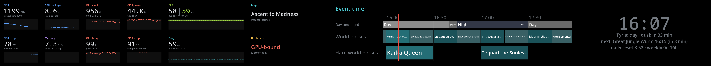

# letterbox

Guild Wars 2 in a letterbox on Linux with KDE Plasma. The game renders only a wide strip of your monitor
and the free space above it becomes a stats bar with FPS, ping, CPU and GPU sensors, the event timer,
a clock and more.

I won't bore you with why I built this. If you're curious, there's a [section at the end](#why-i-built-this).



## What it does

- GW2 runs windowed without borders at full width but less height, for example 3840×1800 on a 4K
  monitor. That's 17 % fewer pixels for the GPU, and the game looks the same, just wider.
- The strip that's left shows a bar you can put together yourself. Pick tiles, stack them, put them
  side by side, make some wider than others.
- Everything is set up in a settings app with a live preview of the real bar.
- When GW2 closes, your monitor and panels go back to normal.

### Tiles

| Tile | Shows |
|---|---|
| FPS | current FPS, optionally with the 60 s average, plus the 1 % low |
| Ping | round trip time to the GW2 server and the 60 s average |
| CPU, CPU package, CPU temp | clock, power and temperature |
| GW2 main thread | load of the game's busiest thread, the usual culprit when the CPU looks idle but FPS drop |
| GPU power, clock, busy, temp, VRAM | AMD GPUs |
| Map, Combat, Character | where you are, how long you've been fighting, who you're playing |
| Bottleneck | a guess at what holds the game back right now, GPU or CPU |
| Event timer | world bosses and metas as a timeline like the one on the wiki |
| WvW matchup | the three teams by victory points, the current skirmish's score, time left and points per tick |
| WvW map | who holds what on the map you're on and the latest captures |
| Squad | squad or party size, the commander, your subgroup and everyone's professions as a colour bar (needs Nexus, see below) |
| Fans, Memory, Network | the rest |
| Trading Post | your watchlist with official item icons, prices in gold, silver and copper, the trend since yesterday, an alert price and what's waiting in your delivery box |
| Session earnings | gold and every currency you made since the game started, gold per hour |
| Wizard's Vault | daily and weekly progress and what's still open |
| Birthdays | your characters' next birthdays (today and tomorrow also show up under the clock) |
| Gem exchange | what a gem costs and how many 100 gold buy |
| Run timer | a stopwatch for metas, fractals or jumping puzzles, click it or press Meta+Shift+T |
| Playtime | time played today and this session, with an optional break reminder |
| Now playing | Spotify, Deezer or YouTube in the browser, any player with title, artist and cover, click to pause |
| Batteries | mouse, keyboard, headset and controller, with a warning before they run out |
| Notifications | Discord, mail and other desktop notifications, readable without leaving the game |
| Weather, Calendar | weather for your town and your next appointments from an iCal link |
| Scores | NBA and other leagues, live games first, your team highlighted |
| Window | any window held in the tile's place, for example NBA League Pass in Chrome, a stream or a chat |

The event timer also greys out world bosses you've already done today. Tiles that use your account need a GW2
API key, everything about them is set up in the settings under Extras.

Every number tile can show the number, a graph of the last 30 s to 5 min, or both, in a colour of your
choice.

### Event timer and clock

- A timeline of world bosses, map metas, festivals and the Tyria day and night cycle, grouped by expansion
  and Living World season. Pick whole expansions or single maps, set how far ahead it looks, how tall
  each row is and how much space sits between them.
- The meta of the map you're on can join the timeline on its own.
- Under the clock you get the Tyria time of day, the next event and the time to daily and weekly reset.
- A start warning a few minutes before a boss, in a colour you choose, with blinking and a sound if you
  want them.
- The clock can be digital, analog or minimal.

### WvW

The WvW tiles get the matchup from the GW2 API every 30 seconds while they're shown. The game doesn't tell
outside programs which matchup you're in, so they need an API key in the settings, made at
[account.arena.net/applications](https://account.arena.net/applications). Give it the permissions
account, wallet, characters, progression and tradingpost, which covers the WvW tiles and the account tiles (Trading Post, earnings, Wizard's Vault,
birthdays, bosses done).

### Squad tile and the Nexus bridge

The game doesn't tell outside programs who's in your squad. Addons in [Nexus](https://raidcore.gg/nexus) do
get that through Raidcore's RealTime API. So letterbox comes with a tiny Nexus addon, `letterbox bridge`,
that writes your squad and a few game states to a file in its addon folder once per second. Under Proton
the game folder is a normal folder on Linux, so the bar just reads it. Nothing gets sent anywhere and
nothing in the game is automated.

The installer puts the addon in place if you use Nexus (or run `letterbox setup-bridge`). In the game, load
"letterbox bridge" in Nexus and install "RealTime API" from the Nexus library. The source is in
[`nexus-bridge/`](nexus-bridge), built with MinGW (`nexus-bridge/build.sh`).

### More

- Four themes, your own colours for every tile and text, and your own fonts.
- An ambient background that picks up the colours at the edge of the game image.
- Or your own picture as the background. Move and zoom the part you want with the mouse, then darken and
  blur it until the text reads well.
- In combat the bar can dim itself or show only warnings like a hot GPU or a ping spike.
- Profiles, so you can keep one layout for WvW and one for open world.
- Hotkeys that work in game. **Meta+Shift+B** cycles the bar between full, compact, clock only and off.
  **Meta+Shift+M** drops a lag marker (a timestamp in `~/.local/share/letterbox/markers.log`) so you can
  find that one laggy moment in your logs later. **Meta+Shift+T** starts and stops the run timer tile. **Meta+Shift+W** sets the window tile's window free and puts it back.

## Requirements

- KDE Plasma 6 on Wayland. The placement is done by a KWin script, so other desktops won't work.
- GW2 through Steam with Proton. Lutris, Heroic, Bottles and plain Wine installs are found too, they just
  need the `letterbox run` part added to their launch command by hand.
- Python 3 with GTK 4, pycairo and NumPy. The installer offers to install them on Arch, Fedora,
  Debian/Ubuntu and openSUSE. Only Arch is tested so far.
- [MangoHud](https://github.com/flightlessmango/MangoHud) for the FPS tiles.
- An AMD GPU for the GPU tiles. Without one those tiles are hidden and everything else works.

## Install

```sh
git clone https://github.com/flo-coast/letterbox.git && cd letterbox && ./install.sh
```

Run it as your normal user and answer a few yes/no questions. It takes care of

- the missing Python packages
- the files in `~/.local/share/letterbox`, the `letterbox` command, the app "Letterbox settings" and the
  hotkeys
- MangoHud logging for the FPS tiles. An existing GW2 MangoHud config keeps everything and gets three
  lines added. Without one you get a config that only logs and shows no overlay, the bar has the FPS anyway.
- the GW2 logger service (asks for sudo). It reads GW2's MumbleLink, the official interface for overlays,
  for the map, combat, character and thread tiles. Under Proton that memory lives inside the game process,
  which is why it needs root.
- `letterbox run` in GW2's Steam launch options, in front of whatever you already have there. Steam has to
  be closed for that, the installer offers to close it.
- switching letterbox mode on

At the end it shows what it found. Run `letterbox doctor` anytime to see that again.

```
letterbox doctor
  ok  Monitor           DP-1 3840x2160, game 3840x1800
  ok  GPU               AMD Navi 14 [Radeon RX 5500/5500M / Pro 5300/5300M/5500M]
  ok  GW2 settings      ~/.local/share/Steam/steamapps/compatdata/1284210/pfx/...
  ok  Launch option     MANGOHUD=1 ~/.local/share/letterbox/letterbox run %command%
  ...
```

Then start GW2 through Steam as usual.

Letterbox mode keeps its own copy of GW2's graphics settings. `letterbox off` brings back the fullscreen
ones, so switching back and forth doesn't mess up either.

### System settings

Everything the installer finds on its own is in the settings app under **System**. There you can pick the
monitor and the GPU from a list, point letterbox to GW2's graphics settings, game folder or MangoHud logs if
they live somewhere unusual, enter the API key and run the same check as `letterbox doctor`. The GW2 logger
picks up the GPU you choose there too.

For reference, these end up in `~/.config/letterbox/config.json` as `output`, `gpu`, `gfx_settings`,
`game_dir`, `mangohud_dir` and `api_key`. An empty value means automatic.

## Commands

```
letterbox on [height]   letterbox mode on (GW2 closed)
letterbox off           back to normal fullscreen
letterbox status
letterbox run <cmd>     for the Steam launch options (the installer puts it there)
letterbox start|stop    what run does around the game, if you want to hook it up elsewhere (gamemode)
letterbox doctor        what letterbox found and what's missing
letterbox setup-launch  add letterbox run to GW2's Steam launch options (Steam closed)
letterbox setup-bridge  put the Nexus bridge addon into GW2's addons folder
```

## Other games and systems

letterbox is made for Guild Wars 2 on Linux with KDE Plasma and that's all it supports right now. The
window placement and the sensor tiles would work for other games too, the rest (switching the game to
windowed, events, WvW, squad) is GW2 only. Other desktops like GNOME and other systems like Windows would
each need their own way of placing the windows.

If you'd like it for another game, desktop or system, [open an issue](https://github.com/flo-coast/letterbox/issues/new)
and say which one. If a few people ask for the same thing, it's more likely to happen.

## Uninstall

`./uninstall.sh` removes the program, the hotkeys, the GW2 logger, the Nexus bridge addon and `letterbox run`
from the Steam launch options (Steam has to be closed for that). It switches letterbox mode off first, so GW2
gets its fullscreen settings back. Your settings, lag markers, MangoHud logs and the window tile's Firefox
profile stay, `./uninstall.sh --purge` takes those too. A MangoHud config letterbox made or extended stays as
well, the original is next to it as `.before-letterbox`.

## Good to know

- Ping comes from the kernel's numbers for the game's connection. Nothing extra goes over the network.
- The logger writes one CSV per day to `/var/log/letterbox` and keeps 14 days, or all of them with
  `LETTERBOX_KEEP_DAYS=0` in the service. Those files include your character name and position. They stay
  on your machine.
- The event times come from the GW2 wiki's event timer via
  [giovazz89/gw2-api-event-timers](https://github.com/giovazz89/gw2-api-event-timers). The installer
  downloads them, and "Update event data" in the settings app fetches them again.
- On T2 MacBooks with my t2pm probe running, two more tiles show up for the Apple SMC power budget. On
  any other machine they simply aren't there.

## Why I built this

My MacBook Pro 16" (2019) has an AMD Radeon and runs Arch. On an external 4K monitor GW2 pushes that GPU
to its limit, and in big fights it drops frames and stutters. Rendering fewer pixels takes some of that
load off. On a 16:9 monitor the game doesn't really need all of its height anyway, so I gave it a wider
picture and used the strip that's left for the things I kept checking while playing, which I didn't
want to cover the game with an overlay.

Power management on that Mac is its own story, see [t2-cruise](https://github.com/flo-coast/t2-cruise).

## Credits

Written by **flo-coast** (2026), with Claude (Anthropic) as a coding assistant.
Event timer data from the GW2 wiki via [giovazz89/gw2-api-event-timers](https://github.com/giovazz89/gw2-api-event-timers).
The bridge uses the Nexus and RealTime API headers by [Raidcore](https://raidcore.gg) (MIT).
Not affiliated with ArenaNet or NCSOFT. Guild Wars 2 is a trademark of ArenaNet, LLC.

## License

[GPL v3 or later](LICENSE). No warranty. letterbox changes GW2's graphics settings file (it keeps
copies next to it) and the hiding mode of your Plasma panels while the game runs.
